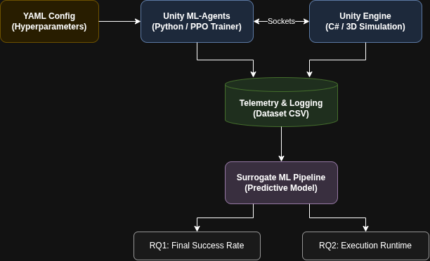

# The Game of Choice

The game we chose to work on is Push Block. The reason we chose this
game is so that we can check if our original assumption holds, that
being, that the fully trained AI will end up pushing it straight into
the zone.

We have also decided to go with this game because it does not require
heavy computational power: not everyone in the group has a computer with
a powerful CPU and/or a dedicated GPU. A large part of the project is
about collecting data; thus, every person in the group must be able to
collect data with their own computer.

# Research Question

- How accurately can we predict the final success rate of an ML-Agent
  from its pre-training configuration?

- How do variations in batch size and learning rate affect the total
  training time and policy stability of the PPO agent in PushBlock?

## Sub-questions for RQ1

To evaluate how accurately the final success rate of a PPO agent can be
predicted from its initial configuration, we divide RQ1 into three
measurable sub-questions:

- **SQ1.1 (Prediction Accuracy):** How accurately can supervised
  regression models predict the final success rate of a PushBlock agent
  using only its pre-training hyperparameters?

- **SQ1.2 (Feature Importance):** To what extent do learning rate and
  batch size contribute to predicting the agent's final success rate?

## Sub-questions for RQ2

To thoroughly analyze the effects of hyperparameter variations on
training dynamics, we decompose RQ2 into three measurable sub-questions:

- **SQ2.1 (Wall-clock Duration vs. Sample Efficiency):** How does
  scaling the batch size ($64, 128, 256$) impact the total wall-clock
  training time compared to the number of environment steps required to
  reach the target reward threshold?

- **SQ2.2 (Stability and Variance):** How do different learning rate
  magnitudes ($1 \times 10^{-4}, 3 \times 10^{-4}, 1 \times 10^{-3}$)
  influence the policy's stability, measured by the rolling reward
  variance and catastrophic performance drops across consecutive
  training intervals?

- **SQ2.3 (Hyperparameter Interaction):** Is there an interaction effect
  between batch size and learning rate that leads to policy collapse or
  training stagnation in the PushBlock task?

## Grounding and Academic Justification for RQ1

This research question is motivated by previous studies on
hyperparameter sensitivity and performance prediction in reinforcement
learning:

- **Hyperparameter Sensitivity:** Eimer et
  al. [@eimer2023hyperparameters] demonstrated that hyperparameter
  configurations significantly influence the performance of
  reinforcement learning agents. Their findings support investigating
  whether initial configurations can be used to predict final success
  rates.

- **Variability in RL Experiments:** Henderson et
  al. [@henderson2018matters] showed that reinforcement learning results
  can vary considerably between experimental runs. This highlights the
  importance of using multiple random seeds and evaluating prediction
  accuracy on unseen data.

- **Surrogate Model Approach:** Instead of executing a complete training
  run for every new configuration, our project investigates whether
  supervised regression models can estimate the final success rate from
  pre-training settings. We compare Random Forest Regression with
  simpler baselines to evaluate whether such predictions are
  sufficiently accurate to be useful.

## Grounding and Academic Justification for RQ2

This research question is grounded in established reinforcement learning
literature and directly motivated by our preliminary systematic search:

- **Empirical Sensitivity in PPO:** In foundational Proximal Policy
  Optimization (PPO) literature, Schulman et al.[@schulman2017proximal]
  demonstrate that learning rate governs policy step sizes while batch
  size controls gradient variance. We apply this idea to the discrete
  action PushBlock environment by changing the learning rate and batch
  size and observing their effects on training.

- **Direct Evidence from Adde et al.:** In our literature review, Adde
  et al.[@adde2024hyperparameter] explicitly analyzed hyperparameter
  optimization for simulated RL agents, identifying learning rate and
  batch size as the two most influential hyperparameters determining
  whether training succeeds or completely fails. We apply their finding
  directly to the discrete-action PushBlock benchmark.

- **Resource and Runtime Modeling:** Wang et al.[@wang2024heterogeneous]
  established that predicting RL training duration requires decoupling
  algorithmic sample efficiency (simulation steps) from hardware
  computation time per batch update. Since batch size directly alters
  per-iteration compute overhead, analyzing its effect is essential for
  hardware-aware resource planning.

- **Need for Controlled Evaluation:** Previous research also shows that
  training results can vary because of
  hyperparameters,[@liu2023efficient] random seeds, and other factors.
  Therefore, looking only at the final reward may not give a complete
  picture of training quality. In our study, we consider both total
  training time and policy stability to determine not only how quickly
  PPO trains, but also how consistently the agent learns under different
  batch-size and learning-rate configurations.

# Literature Review

Schulman et al. introduced Proximal Policy Optimization (PPO), which
learns through repeated minibatch updates using collected experience.
Their experiments demonstrated a favourable balance between sample
efficiency and training time, providing the algorithmic basis for our
investigation of PPO in PushBlock [@schulman2017ppo].\
Eimer et al. showed that hyperparameter choices can substantially affect
final performance and sample efficiency. They also found that effective
configurations can depend on random seeds, highlighting the importance
of independent testing. These findings support our investigation of
batch size and learning rate as predictors of final success rate
[@eimer2023hyperparameters].\
Meanwhile, Henderson et al. demonstrated that randomness in deep
reinforcement learning can produce different outcomes under similar
settings. Their findings emphasise the need for repeated experiments and
consistent reporting when comparing training time and policy stability
[@henderson2018matters].\
Together, these studies motivate systematic experimentation while
highlighting variability in training outcomes. Our project applies these
principles to PushBlock, using supervised learning to predict final
success rate and examining how batch size and learning rate affect
training time and performance across runs.

# Software planning

## System Architecture Overview

The software infrastructure for this project is engineered across two
parts:

1.  Simulation and Telemetry (Data Generation): Physical simulation in
    the Unity engine (C#) with the Proximal Policy Optimization (PPO)
    trainer in Unity ML-Agents (Python) executing training runs and
    recording telemetry.

2.  Surrogate Machine Learning Predictive Modeling: A ML model that will
    run data to train estimators predicting task performance
    ($\text{RQ1}$) and run duration/stability ($\text{RQ2}$).

<figure id="fig:system_architecture" data-latex-placement="htbp">

<figcaption>Overview of the system architecture</figcaption>
</figure>

## Components and Technologies

Each component in the architecture has clearly responsibilities and
technology stacks:

- Unity Game Engine (C# / Simulation Runtime): It manages the 3D physics
  of the PushBlock benchmark arena, extracts agent observations using
  ray-cast (14 spherical rays emitting 70 continuous observation
  floats), it maps the 7 discrete actions into translation and rotation
  in the environment, while enforcing giving step penalties (-0.0025)
  and goal terminal rewards (+1.0)

- Unity ML-Agents Toolkit (Python / DRL Trainer Layer): Deployed within
  a Python 3.10 virtual environment, it executes the Proximal Policy
  Optimization (PPO) algorithm, using training hyperparameters from
  external .yaml configuration files.

- Custom Telemetry and Logging Script (Group-Authored Code): A custom
  script that run alongside the simulation to capture values we care
  about from each training session like pre-training hyperparameters,
  execution runtime, hardware specifications, and the agent's final task
  performance and then creating a record into a CSV dataset file to be
  shared with the course repository.

- Custom Surrogate ML Pipeline (Group-Authored Code): A standalone
  script that get CSV data and trains a machine learning model on these
  data to predict expected training duration and final success rates
  directly from initial setup configurations.

## Communication and Data Flow

Communication across the system is organized into decoupled parts:

- Real-Time Environment Communication (Unity and ML-Agents): During
  training, Unity passes sensory ray-cast observations to the Python
  ML-Agents toolkit via local sockets, and receives back the actions
  selected by the neural network.

- Configuration and Data Pipeline (YAML $\longrightarrow$ CSV
  $\longrightarrow$ Surrogate Model): Hyperparameters are defined in a
  YAML configuration file; once a run finishes, our script captures the
  initial settings, measured execution time and evaluated task success
  rate, transforming it into a data to be appended to the CSV dataset.

## Version Control and Environment Setup

- The complete codebase is tracked in a public GitHub repository that
  will use branching workflows with changes integrated into the main
  branch via pull requests.

- Python package dependencies are pinned in a requirements.txt file
  inside a standard virtual environment, avoiding library version
  problem across member all the group members' computer.

# Data Collection and Experimental Setup

To answer our research questions, we will run systematic training
experiments in PushBlock using Unity ML-Agents with PPO. Each run will
test a specific set of hyperparameters, and we will record the
performance and training duration to build our dataset for the surrogate
model.

## Hyperparameters to Test

Since RQ2 focuses on batch size and learning rate, we will test
combinations of the following values while keeping the rest of the
PushBlock environment default:

- **Learning Rate:** $1 \times 10^{-4}$, $3 \times 10^{-4}$ (default in
  ML-Agents), and $1 \times 10^{-3}$.

- **Batch Sizes:** $64$, $128$, and $256$.

- **Random Seeds:** We will repeat each combination across 3 different
  random seeds because reinforcement learning results can vary
  significantly between runs.

## Variables and Logged Data

During each training session, we will measure and log:

- **Final Success Rate:** The percentage of times the agent successfully
  pushes the block into the goal zone during the final 100 episodes of
  training. This serves as our target variable for RQ1.

- **Training Time:** The real-world time (wall-clock time in minutes)
  needed to finish training up to 500,000 steps.

- **Simulation Steps to Converge:** The number of environment steps the
  agent takes before reaching a steady reward. We record this because
  our group members have different hardware, and simulation steps
  provide a hardware-independent way to compare learning speed.

- **Policy Stability:** How stable the agent's rewards remain near the
  end of training rather than dropping unexpectedly.

## Surrogate Model Approach

Once we gather all the training runs, each run will form a data point in
our dataset where the inputs are the hyperparameter settings and the
outputs are the success rate and training duration. We will train simple
regression models (such as Random Forest Regression and linear
baselines) to test how accurately they can predict these outcomes
without needing to run the full Unity simulation every time.

# Time Schedule

::: tabularx
@ l \>

X \>

p1.9cm l l c l @

**ID** & **Task Description** & **Assignee** & **Start** & **End** &
**Days** & **Status**\
\
A1 & Unity/C# Telemetry Hooks (wall-clock time, steps) & Savvas and
Raluca & 15 Oct & 20 Oct & 6 & Not started\
A2 & RAM Profiling & Resource Usage Scripts (peak/avg RAM), incl. smoke
test on own hardware & Ivana & Anna & 12 Oct & 20 Oct & 9 & Not started\
\
B1 & Benchmark Environments Setup & Headless Run Verification & Savvas
and Raluca & 12 Oct & 14 Oct & 3 & Not started\
B2 & Training Configuration Matrix (PPO, hyperparams, seeds) & Riccardo
& Demetrios & 17 Oct & 21 Oct & 5 & Not started\
\
C1 & Batch 1 DRL Training Runs & Log Collection & Savvas and Raluca & 21
Oct & 1 Nov & 12 & Not started\
C2 & Batch 2 Extended Runs & Crash/Error Monitoring & Ivana & Anna & 26
Oct & 6 Nov & 12 & Not started\
\
D1 & Dataset Schema Definition & Standard Column Names & Riccardo &
Demetrios & 12 Oct & 16 Oct & 5 & Not started\
D2 & Canvas Project Week Sample Data File Submission (due Fri 30 Oct) &
Riccardo & Demetrios & 22 Oct & 28 Oct & 7 & Not started\
D3 & Shared Repository Integration (DennisSoemers/BCS2720...) & Riccardo
& Demetrios & 29 Oct & 4 Nov & 7 & Not started\
\
E1 & Feature Preprocessing Pipeline (built on schema and sample file) &
Ivana & Anna & 21 Oct & 27 Oct & 7 & Not started\
E2 & ML Baseline Models on first collected runs & Ivana & Anna & 28 Oct
& 5 Nov & 9 & Not started\
\
E3 & Project Week Canvas Documentation Drafting & Savvas and Raluca & 22
Oct & 28 Oct & 7 & Not started\
E4 & Public GitHub Repo Audit & Reproducibility Guidelines & Savvas and
Raluca & 2 Nov & 6 Nov & 5 & Not started\
F & Midway Evaluation 20-Min Presentation Preparation & Everyone & 4 Nov
& 8 Nov & 5 & Not started\
:::

# Predicted Risks and Resolutions

During the project, we expect several risks that could affect the data
collection and the reliability of our results.

1.  The agent may take longer to learn than expected: Some training runs
    might require a lot of time before the agent learns how to
    successfully push the block into the target zone. Resolution: We
    will first use shorter training runs to test our setup. Once we know
    that everything works, we can increase the training time for the
    actual experiments.

2.  Different results between runs: The agent might not get exactly the
    same results every time, even when we use the same settings.
    Resolution: We will repeat some experiments and compare the results
    instead of relying on only one run.

3.  Large amount of data collection: Collecting enough runs to make
    meaningful comparisons may take a significant amount of time and
    computational resources. Resolution: We will divide the experiments
    between group members and use a consistent experiment configuration
    and naming system. We will also automate data collection where
    possible.
